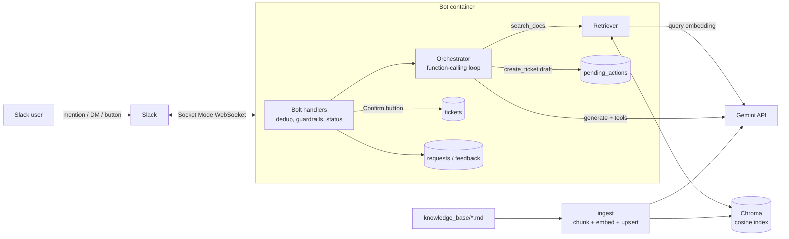

# slack-support-bot

A Slack support bot that answers IT questions from an internal knowledge base using retrieval-augmented generation (RAG), cites its sources, and opens support tickets through tool calling, always with a human confirmation step.

It is a portfolio project focused on production-minded engineering: grounded answers with guardrails, structured logs, request metrics, an evaluation harness, unit tests with fakes, Docker and CI.

> The knowledge base describes **Acme**, a fictional company. All articles, systems, URLs and phone numbers are made up.

## Features

- **Ask by mention or DM**: replies in a thread, in the user's language (English or Portuguese).
- **Grounded answers with citations**: Gemini answers only from retrieved knowledge base sections and cites them as `Title > Section`. Answers without valid citations are never shown.
- **Honest "I don't know"**: when retrieval confidence is low, the bot says so and offers a pre-filled ticket draft.
- **Tool calling**: `search_docs(query)` and `create_ticket(title, description, priority)`.
- **Human-in-the-loop tickets**: `create_ticket` only drafts. The ticket is written to SQLite only after the requester clicks **Confirm**. Drafts expire, and double clicks cannot create duplicates.
- **Feedback**: every answer has 👍 / 👎 buttons, stored per request.
- **`status` command**: uptime, indexed chunks, and request count, error count and average latency over the last 24 hours.
- **Reliability**: timeouts and exponential-backoff retries on Gemini calls, friendly error messages, de-duplication of Slack retries and duplicate events, a heartbeat-based Docker healthcheck.
- **Observability**: JSON logs with request id, hashed user id, latency, model, tokens, retrieved chunk ids and scores, tool calls and errors, persisted to a `requests` table.
- **Evaluation**: a 30-question golden set with retrieval hit@k, LLM-as-judge correctness, citation accuracy and refusal rates.

## Architecture



Request flow:

1. A mention or DM arrives over Socket Mode. The handler ignores bot messages and edits, de-duplicates by `event_id` and `channel+ts`, and rejects messages over `MAX_INPUT_CHARS`.
2. The orchestrator calls Gemini with the two tools. The first call is forced to use a tool, so every answer starts from a search (or a ticket draft).
3. `search_docs` embeds the query, queries Chroma and returns only chunks with cosine similarity at least `RETRIEVAL_MIN_SCORE`, numbered for citation.
4. The final answer must cite those numbers. Otherwise, or if the model replies `NO_ANSWER`, the bot sends the "I don't know" message with a ticket draft.
5. Ticket drafts are stored as pending actions with an expiry. **Confirm** inserts the ticket in the same transaction that resolves the draft.
6. Every request is logged as JSON and stored in the `requests` table.

### Project layout

```
src/support_bot/
  app.py            # builds the Bolt app, runs Socket Mode, heartbeat and cleanup loop
  __main__.py       # python -m support_bot
  config.py         # pydantic-settings, all env vars
  orchestrator.py   # function-calling loop, citations, grounding checks
  tools.py          # tool declarations and argument validation
  llm/client.py     # google-genai wrapper: timeouts, retries, typed responses
  llm/prompts.py    # system prompt and prompt builders
  rag/chunking.py   # Markdown -> heading-based chunks with content-hash ids
  rag/store.py      # Chroma store and retriever
  ingest.py         # idempotent ingestion CLI
  slack/handlers.py # message and button handlers (Bolt-independent, unit-tested)
  slack/blocks.py   # Block Kit builders
  storage/db.py     # SQLite schema, migrations and queries
  status.py, health.py, observability.py, logging_setup.py, i18n.py
knowledge_base/     # fictional Acme runbooks and FAQs
evals/              # golden.jsonl, run.py, results/
tests/              # pytest suite with Slack and Gemini fakes
docs/               # ADRs and runbook
```

## Quickstart

### 1. Create the Slack app

1. Go to <https://api.slack.com/apps> > **Create New App** > **From a manifest**, pick your workspace, and paste [`slack-app-manifest.yaml`](slack-app-manifest.yaml).
2. **Basic Information > App-Level Tokens** > **Generate Token and Scopes**, add the `connections:write` scope. This is `SLACK_APP_TOKEN` (`xapp-...`).
3. **Install App** > **Install to Workspace**. The **Bot User OAuth Token** is `SLACK_BOT_TOKEN` (`xoxb-...`).
4. Invite the bot to a channel with `/invite @Support Bot`, or open a DM with it.

### 2. Get a Gemini API key

Create a key in [Google AI Studio](https://aistudio.google.com/apikey). This is `GEMINI_API_KEY`.

### 3. Configure

```bash
cp .env.example .env
# edit .env: tokens, API key and a random USER_ID_HASH_SALT
```

### 4a. Run with Docker (recommended)

```bash
docker compose build
docker compose run --rm ingest   # index the knowledge base (one-off)
docker compose up -d bot
docker compose logs -f bot
```

### 4b. Run locally

Requires [uv](https://docs.astral.sh/uv/) (it installs Python 3.12 if needed).

```bash
uv sync
uv run support-bot-ingest        # or: uv run python -m support_bot.ingest
uv run support-bot               # or: uv run python -m support_bot
```

### Try it

- `@Support Bot how do I unlock my account?`: a cited answer.
- `@Support Bot qual o cardápio do refeitório?`: "I don't know" in Portuguese, with a ticket draft.
- `@Support Bot open a ticket: printer PRN-SP-0412 is jammed`: a draft with **Open ticket** / **Cancel**.
- `status` in a DM: uptime and 24-hour metrics.

## Configuration

All settings are environment variables (or `.env`). See [`.env.example`](.env.example).

| Variable | Default | Description |
|---|---|---|
| `SLACK_BOT_TOKEN` | – (required for the bot) | Bot User OAuth Token (`xoxb-...`) |
| `SLACK_APP_TOKEN` | – (required for the bot) | App-level token with `connections:write` (`xapp-...`) |
| `GEMINI_API_KEY` | – (required) | Gemini API key |
| `GEMINI_MODEL` | `gemini-3.8-flash` | Generation model (function calling) |
| `GEMINI_JUDGE_MODEL` | `GEMINI_MODEL` | Model used as eval judge |
| `GEMINI_EMBEDDING_MODEL` | `gemini-embedding-2` | Embedding model |
| `GEMINI_EMBEDDING_DIM` | `768` | Embedding dimension (128 to 3072) |
| `GEMINI_TIMEOUT_SECONDS` | `30` | Timeout per Gemini request |
| `GEMINI_MAX_ATTEMPTS` | `4` | Attempts for retryable errors (408, 429, 5xx, network) |
| `GEMINI_MAX_OUTPUT_TOKENS` | `1024` | Max output tokens per generation |
| `KNOWLEDGE_BASE_DIR` | `knowledge_base` | Markdown source directory |
| `RETRIEVAL_TOP_K` | `4` | Chunks returned per search |
| `RETRIEVAL_MIN_SCORE` | `0.65` | Minimum cosine similarity for a chunk to be used |
| `MAX_INPUT_CHARS` | `2000` | Longer messages are rejected |
| `PENDING_ACTION_TTL_SECONDS` | `900` | How long a ticket draft can be confirmed |
| `CLEANUP_INTERVAL_SECONDS` | `600` | How often expired drafts and event keys are purged |
| `PROCESSED_EVENT_TTL_SECONDS` | `86400` | De-duplication window for Slack events |
| `DATA_DIR` | `data` | Chroma index, SQLite database and heartbeat file |
| `LOG_LEVEL` | `INFO` | Log level |
| `USER_ID_HASH_SALT` | `change-me` | Secret salt for hashing user ids in logs and metrics |
| `HEARTBEAT_INTERVAL_SECONDS` | `30` | Heartbeat write interval |
| `HEARTBEAT_MAX_AGE_SECONDS` | `90` | Healthcheck fails when the heartbeat is older than this |

## Ingestion

```bash
uv run support-bot-ingest            # incremental and idempotent
uv run support-bot-ingest --rebuild  # drop and rebuild the index
```

Markdown is split by H2/H3 headings (the H1 is the document title). Chunk ids are content hashes, so unchanged chunks are not re-embedded, edited chunks are replaced and removed chunks are deleted. The collection records the embedding model and dimension. If they change, the bot and ingestion stop with a message asking for `--rebuild`.

## Tests

```bash
uv run pytest
uv run ruff check . && uv run ruff format --check .
```

The suite uses in-memory fakes for Slack and Gemini, a deterministic bag-of-words embedder and temporary Chroma and SQLite stores, so it needs no network or secrets. It covers chunking, ingestion idempotency, retrieval, the tool loop and dispatch, the ticket confirmation flow, the status command, de-duplication, feedback, error handling and the eval harness. CI runs lint, format check and tests on every push and pull request.

## Evaluation

```bash
uv run python -m evals.run                  # full run (calls the Gemini API)
uv run python -m evals.run --retrieval-only # retrieval metrics only, cheaper
```

[`evals/golden.jsonl`](evals/golden.jsonl) has 30 questions: 25 answerable (English and Portuguese) with the expected source document and a short reference answer, and 5 that are not covered by the knowledge base, one of them a prompt-injection attempt. The runner reports:

- **Retrieval hit@1 / hit@k**: the expected document is among the top-k chunks.
- **Answer correctness**: an LLM judge grades each answer against the reference (0 wrong, 1 partial, 2 correct). Refusals of answerable questions count as incorrect.
- **Citation accuracy**: the expected document is among the cited sources.
- **Correct-refusal rate**: unanswerable questions that got "I don't know".
- **False-refusal rate**: answerable questions that got "I don't know".
- A **calibration table** for `RETRIEVAL_MIN_SCORE`.

Results are written to [`evals/results/latest.md`](evals/results/latest.md). Evals call the real API, so they do not run in CI.

### Results

Retrieval (`gemini-embedding-2`, 768 dims, top-k 4, 2026-11-12):

| Metric | Value |
|---|---|
| Retrieval hit@1 | 92% |
| Retrieval hit@4 | 100% |

`RETRIEVAL_MIN_SCORE` calibration (top retrieval score only):

| Threshold | Answerable kept | Unanswerable blocked |
|---|---|---|
| 0.50 | 100% | 0% |
| 0.60 | 100% | 20% |
| **0.65 (default)** | **100%** | **60%** |
| 0.70 | 92% | 80% |
| 0.75 | 76% | 100% |

The default of 0.65 is the highest threshold that keeps every answerable question. The margin is small: the lowest answerable questions (both in Portuguese) score 0.66, and one unanswerable question scores 0.664. The threshold is only the first filter. Unanswerable questions that pass it must still be refused by the model (`NO_ANSWER`, or no valid citation). The calibration uses the raw question as the query, while the bot lets the model write an English search query, which should help Portuguese questions.

Full run (2026-11-12, `RETRIEVAL_MIN_SCORE` 0.65):

| Metric | Value |
|---|---|
| Answer correctness (judge score 2/2) | 88% (22 of 25) |
| Mean judge score (0-2) | 1.88 |
| Citation accuracy | 100% |
| Correct-refusal rate (unanswerable) | 100% (5 of 5, including the prompt injection) |
| False-refusal rate (answerable) | 0% |
| Average latency | 3.27 s |
| Errors | 0 |

> **Model note:** this run used `gemini-3.5-flash-lite` for both generation and judging, not the default `gemini-3.8-flash`, because the default model's free-tier daily quota was exhausted that day. Re-run with the default model before you compare numbers.

The three answers scored 1 (`ssl-02`, `sev-01`, `mail-01`) are correct but leave out a secondary detail from the reference (for example, the 45 GB warning in addition to the 50 GB mailbox limit). None of them contradicted the knowledge base. Two unanswerable questions scored above the threshold (the guest Wi-Fi password and the prompt injection), and the model refused both. See [`evals/results/latest.md`](evals/results/latest.md) for the per-question table.

## Known limitations

- **Same-family judge**: the judge is a Gemini model grading Gemini answers, which can bias scores upward. Use the scores as a regression signal, not an absolute quality measure, and spot-check the per-question table.
- **Small golden set**: 30 questions catch regressions but are not statistically strong.
- **No conversation memory**: each message is answered on its own. A reply like "yes, open it" in a thread does not see earlier messages, so the bot offers a ticket draft with buttons instead.
- **Docker image not yet verified end to end**: the Dockerfile and compose file have not been built and health-checked on a running Docker daemon for v0.1.0.
- **Single instance**: Chroma and SQLite are local to one container. Horizontal scaling needs shared stores (see ADRs 0002 and 0003).
- **Tickets stay local**: confirmed tickets are stored in SQLite, not sent to a real service desk.
- **Language detection for fixed messages** (errors, status) is a simple PT/EN heuristic. LLM answers follow the user's language.
- **De-duplication happens before processing**: if the process crashes mid-request, the Slack retry for that event is skipped.

## Roadmap

- Send confirmed tickets to **GitHub Issues** (or a service desk API) behind a `TicketBackend` interface.
- Thread-aware follow-ups (use earlier messages in the thread as context).
- Hybrid retrieval (BM25 + vectors) and re-ranking.
- A judge from a different model family, and a larger golden set built from thumbs-down feedback.
- Export metrics to Prometheus or OpenTelemetry.
- Shared storage (PostgreSQL + pgvector) for multi-instance deployments.

## Documentation

- [Runbook](docs/runbook.md): operations and troubleshooting
- [ADR 0001: Socket Mode](docs/decisions/0001-socket-mode.md)
- [ADR 0002: Chroma vector store](docs/decisions/0002-chroma-vector-store.md)
- [ADR 0003: SQLite for tickets](docs/decisions/0003-sqlite-for-tickets.md)
